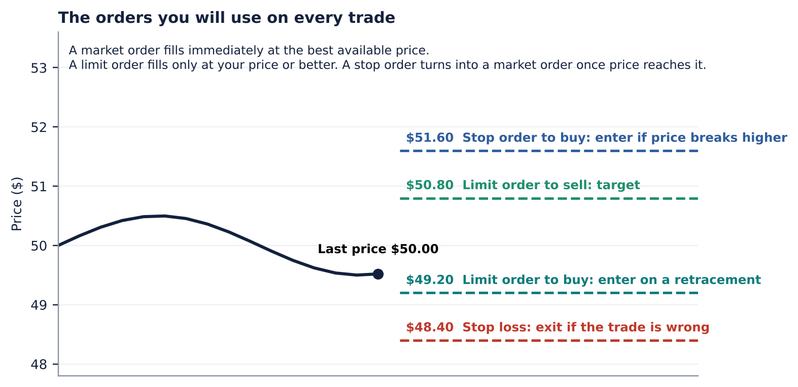

# Week 01 — How Stocks Are Traded: Brokers and Orders

## Learning objectives

- Explain what a broker does and why every trade starts with an order.
- Tell a market order, a limit order and a stop order apart, and say when each is used.
- Place a stop loss and a target as part of the same plan as the entry.
- Open a demo account and place one order of each type.

## Lesson

### The broker and the account

You buy and sell stocks through a broker. The broker holds your account, sends your order to the market and shows your open positions. For this course the broker also gives you a **demo account**: practice money that behaves like a live account, with no risk to your own savings. Use it until your trading journal says you are ready (Week 15).

A stock is quoted in dollars per share. The regular trading session is 9:30 a.m. to 4:00 p.m. Eastern time. The course uses the **daily chart**, so one bar shows one full day, and you do not need to watch the screen all day.

### The three orders

An order is an instruction to your broker. Three kinds cover almost every trade in this course.

| Order | What it does | When you use it |
|---|---|---|
| **Market order** | Buys or sells now, at the best price available | When getting in or out matters more than the exact price |
| **Limit order** | Buys at your price or lower, or sells at your price or higher | To enter on a retracement, or to place a target |
| **Stop order** | Becomes a market order once price reaches your stop price | To enter on a break of a level, or as a stop loss |

Figure 1.1. Four orders around a stock trading at $50.00. All prices are simulated.

### Every trade has three prices

Before you press the button, write three numbers: the **entry**, the **stop loss** and the **target**. The stop loss is the price at which the idea is wrong and you exit. The target is where you plan to take the profit. The difference between entry and stop loss is your **risk**. The difference between entry and target is your **reward**. From Week 12 you will turn those two numbers into a risk reward ratio and a position size.

A stop loss is an order. It is placed with your broker when you enter the trade, not held in your head.

## Worked example

A stock trades at $50.00. Your plan is to buy on a retracement to $49.20, to exit at a stop loss of $48.40 and to take profit at $50.80.

- **Entry:** limit order to buy at $49.20.
- **Stop loss:** stop order to sell at $48.40. Risk per share = $49.20 − $48.40 = **$0.80**.
- **Target:** limit order to sell at $50.80. Reward per share = $50.80 − $49.20 = **$1.60**, which is twice the risk (a risk reward of 1:2).

If price never falls to $49.20, the limit order is not filled and you have no trade. That is a normal outcome, not a failure.

## Exercises

1. Which order would you use to buy only if the stock breaks above $51.00? 

Answer
A stop order to buy at $51.60. It waits until price reaches $51.60 and then becomes a market order.

2. You buy at $20.00 with a stop loss at $19.00 and a target at $22.00. What are the risk and the reward per share, and what is the risk reward? 

Answer
Risk = $1.00, reward = $2.00, so the risk reward is 1:2.

3. Why is a stop loss placed as an order and not kept as a mental note? 

Answer
Because emotion makes people move or ignore a mental stop. An order exits the trade for you at the price you chose when you were calm.

## Lab

Open a demo account with a broker. Place one market order, one limit order and one stop order on three different stocks, then cancel the two that are not filled. Write in your journal what each order did.
