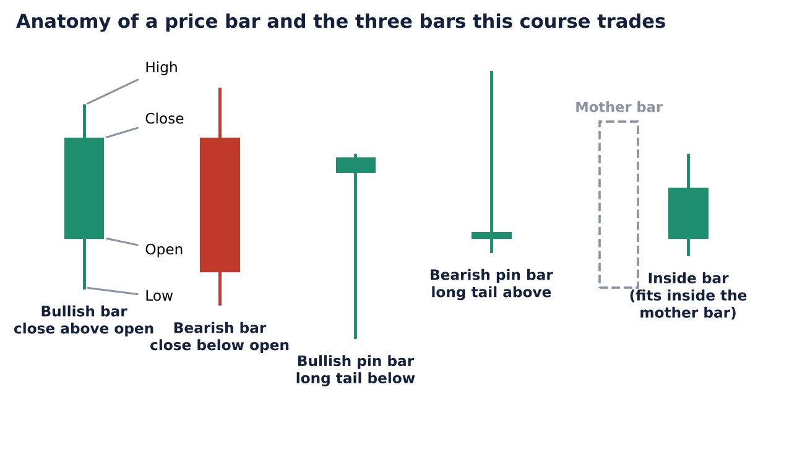
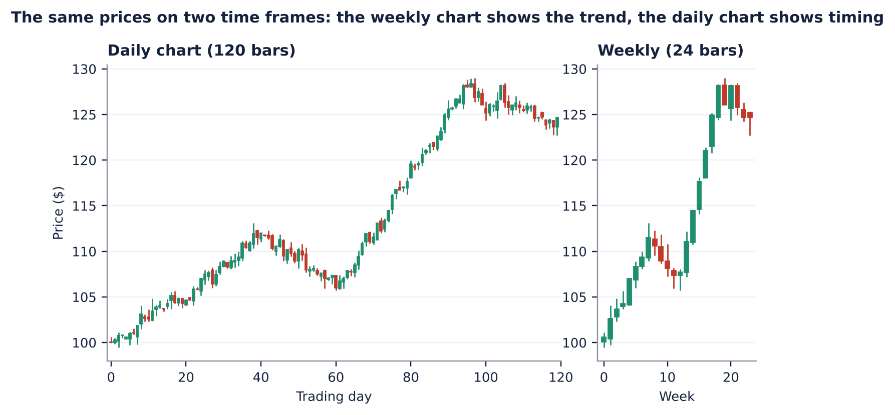

# Week 02 — Reading Price Bars and Time Frames

## Learning objectives

- Name the open, high, low and close of a bar, and its body and tail.
- Recognise a bullish bar, a bearish bar, a pin bar and an inside bar.
- Explain why the weekly chart and the daily chart do different jobs.
- Read a bar as a short story about who controlled the day.

## Lesson

### One bar, four prices

On a daily candlestick chart each bar records four prices for one day: the **open**, the **high**, the **low** and the **close**. The thick part between the open and the close is the **body**. The thin lines above and below are the **tails** (some traders say wicks). A bar with a green body closed above its open and is bullish. A bar with a red body closed below its open and is bearish.

The tail is the most useful part of the bar. A long tail below the body means sellers pushed price down and buyers pushed it back. A long tail above the body means buyers pushed price up and sellers pushed it back. The market tested a price and **rejected** it.

Figure 2.1. The price bars used in this course. The pin bar and the inside bar get their own weeks (6 and 7).

### Time frames

A **time frame** is the length of time one bar covers. In this course you use two.

- The **weekly chart** shows the big picture: the trend and the major levels.
- The **daily chart** shows the detail: the key levels, the signals and the entries.

Always look at the weekly chart first, then the daily chart. A signal on the daily chart that fights the weekly trend is weaker than one that agrees with it.

Figure 2.2. The same prices on two time frames. The weekly chart removes the noise and shows the trend.

### Why the daily chart

A daily bar is complete once the session closes. You can study it after the close, think without pressure and place orders for the next day. Smaller time frames give more bars and more noise, and they demand your attention and your emotions all day. This course does not use them.

## Worked example

Take a daily bar with these prices: open $40.00, high $41.60, low $39.90, close $41.40.

- The close is above the open, so the bar is **bullish**.
- The body is $41.40 − $40.00 = $1.40.
- The upper tail is $41.60 − $41.40 = $0.20 and the lower tail is $40.00 − $39.90 = $0.10.
- Buyers controlled the day. They closed near the high, and sellers never pushed far below the open.

## Exercises

1. A bar opens at $25.00, trades up to $25.30, falls to $23.80 and closes at $25.10. Describe it. 

Answer
A bullish bar with a body of $0.10 and a long lower tail of $1.20: price was pushed down to $23.80 and rejected. It is a bullish pin bar in shape, and it matters only if it appears at a key level.

2. Why do we start on the weekly chart? 

Answer
It shows the trend and the major levels. The daily chart then gives the timing inside that picture.

## Lab

On a daily chart of any stock, label the open, high, low, close, body and tails on ten consecutive bars. Then switch to the weekly chart and write one sentence about the trend you see there.
