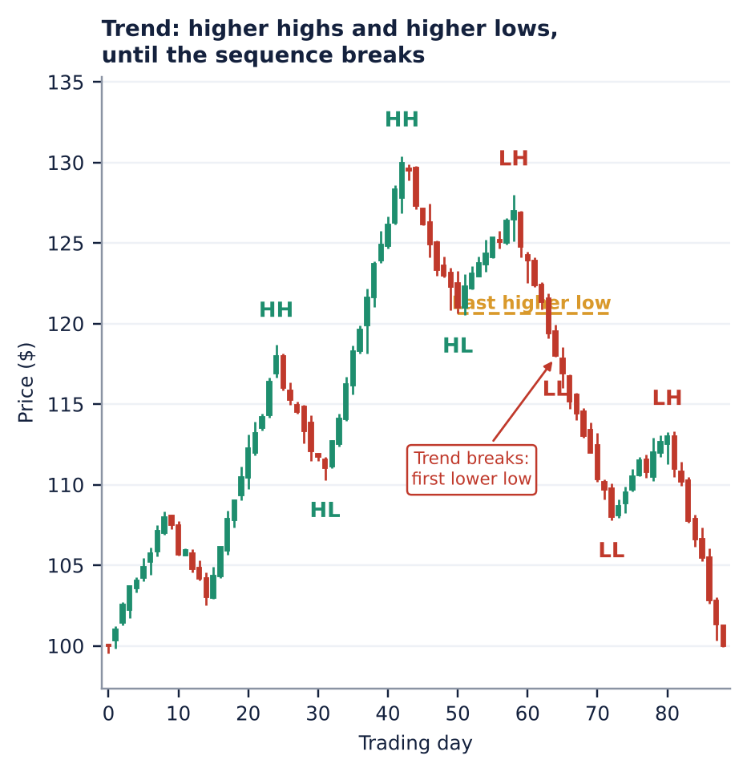

# Week 03 — Trend and Swing Points

## Learning objectives

- Define an uptrend, a downtrend and a sideways market with swing points.
- Mark swing highs and swing lows on a daily chart.
- Explain what it means when the sequence of highs and lows breaks.
- State why trading with the trend is the default in this course.

## Lesson

### Swing points

A **swing high** is a high that has lower highs on both sides. A **swing low** is a low that has higher lows on both sides. The swing points are the skeleton of the chart. Everything else, including the trend, is read from them.

### Three kinds of market

- **Uptrend:** each swing high is higher than the last (a higher high, HH) and each swing low is higher than the last (a higher low, HL).
- **Downtrend:** each swing high is lower (a lower high, LH) and each swing low is lower (a lower low, LL).
- **Sideways:** the swing highs and swing lows stay in a band and do not rise or fall.

Figure 3.1. The trend ends in stages: first a lower high, then a lower low that breaks the last higher low.

### When the trend breaks

A trend is a sequence, and the sequence can end. In the chart, the uptrend keeps printing higher highs and higher lows until a lower high appears. Then price falls through the last higher low and prints a lower low. The uptrend is over, and a downtrend has started. You do not need to predict this. You only need to notice it, and to stop buying the retracements once it happens.

### Why trade with the trend

Most of the time the easiest trade is the one with the trend. Momentum is on your side, retracements are shallow and the targets are often reached. A counter-trend trade can pay well, but it needs a stronger reason (Week 10) and a tighter plan. The default in this course is to trade with the trend.

## Worked example

A stock makes these swing points: low $100, high $108, low $103, high $118, low $111, high $130.

- The swing lows are $100, $103 and $111. Each is higher than the last (HL, HL).
- The swing highs are $108, $118 and $130. Each is higher than the last (HH, HH).
- Both sequences rise, so the trend is **up**. The last higher low is $111. A close below it would be the first warning.

## Exercises

1. The swing highs on a chart are $60, $58, $55 and the swing lows are $50, $47, $44. What is the trend? 

Answer
A downtrend: lower highs and lower lows.

2. In an uptrend the last higher low is $111 and price closes at $109. What does that tell you? 

Answer
The sequence of higher lows has broken. The uptrend is in doubt, so stop buying retracements and wait for the new picture.

## Lab

Pick five stocks. On the weekly chart mark the swing highs and swing lows and write uptrend, downtrend or sideways for each. Then check the daily chart: does it agree?
