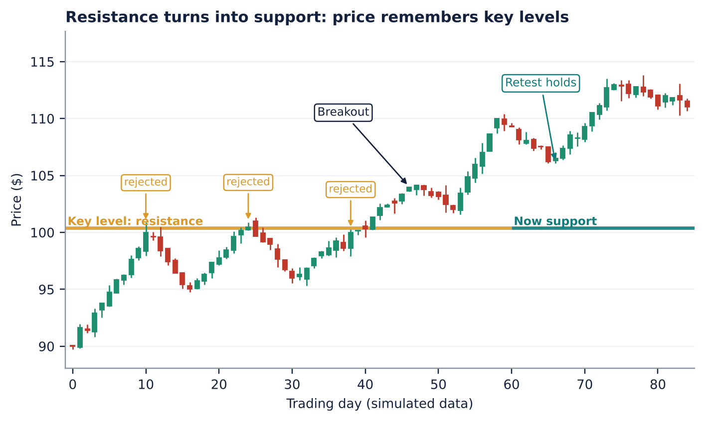

# Week 04 — Key Levels: Support and Resistance

## Learning objectives

- Draw support and resistance levels on a daily chart.
- Say what makes a level a key level.
- Explain why a broken resistance level can turn into support.
- Tell a breakout from a false break.

## Lesson

### What a key level is

**Support** is a price where buyers have repeatedly stopped a fall. **Resistance** is a price where sellers have repeatedly stopped a rise. A **key level** is a support or resistance level that is easy to see, because price has reacted at it more than once and the reaction was clear. If you have to squint to find it, it is not a key level.

Draw levels as horizontal lines on the daily chart, starting from the left and looking for the places where bars turned. A level is an area more than an exact price, so do not worry if bars end a little above or below your line.

### Rejection

Each time price reaches a level and turns, the level is **rejected**. Three clear rejections make a strong level. The pin bar (Week 6) is the single bar that shows rejection best.

### Resistance becomes support

When price breaks above a resistance level and then falls back to it, the old resistance often acts as support. The same is true in reverse: a broken support often becomes resistance. This is the reason you keep old levels on your chart after they break.

Figure 4.1. Price remembers key levels. The same line is resistance on the left and support on the right.

### Breakout and false break

A **breakout** is a close beyond a level. A **false break** is a move beyond the level that fails and closes back inside it. False breaks are common, and Week 8 builds a signal, the fakey, on top of one. Do not buy a breakout simply because price touched the level. Wait for a close.

## Worked example

On the chart above, price tops at about $100 on days 10, 24 and 38, each time falling by 4% to 6%. That is three rejections, so $100 is a key level. On day 46 price closes above it: a breakout. On day 66, price falls back to $100 and holds. A buyer here has the trend, a key level that was proven twice and a retest. That is a trade to plan, though it still needs a signal (Weeks 6 to 8).

## Exercises

1. How many rejections make a level worth drawing? 

Answer
There is no fixed number. Two clear rejections make a level worth watching, and three or more make it strong. What matters is that the reaction is obvious on the daily chart.

2. A stock closes above resistance, then closes back below it the next day. What is this called? 

Answer
A false break.

## Lab

Draw the key levels on three daily charts of stocks. Use only levels that a friend could find without your help. Mark each as support or resistance, and write the date of each rejection.
