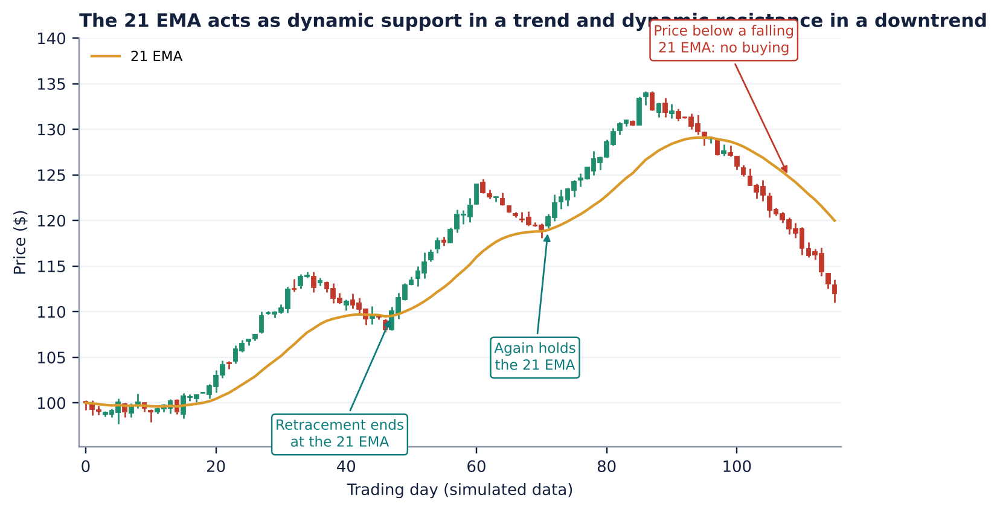

# Week 05 — The 21 EMA as Dynamic Support and Resistance

## Learning objectives

- Say what a moving average is and what the 21 EMA shows.
- Explain how it acts as dynamic support in an uptrend and dynamic resistance in a downtrend.
- Use it to judge how healthy a retracement is.
- Know what the 21 EMA cannot do.

## Lesson

### What it is

A moving average smooths price. The **21 EMA** is an exponential moving average of the last 21 closes, and it gives more weight to the most recent closes. On a daily chart it follows the trend of the last month or so.

### Dynamic levels

The levels in Week 4 are flat. The 21 EMA is a **dynamic** level: it rises in an uptrend and falls in a downtrend. In a healthy uptrend, retracements often stop near the 21 EMA and the trend resumes. In a downtrend, rallies often fail near it.

Figure 5.1. The 21 EMA holds twice in the uptrend. Once price is below a falling 21 EMA, the buying stops.

### How to use it

- **Direction of the 21 EMA:** rising means uptrend, falling means downtrend, flat means sideways.
- **Distance:** a retracement to the 21 EMA is normal. A retracement far through it is a warning.
- **A helper, not a signal:** the 21 EMA never tells you to buy. It adds one more point of agreement, which Week 11 calls confluence.

### What it cannot do

It lags, because it is built from past prices. In a sideways market it crosses back and forth and gives nothing. Treat it as a guide to the trend and a place to look, and let the pin bar, inside bar or fakey provide the signal.

## Worked example

In Figure 5.1, price rises from $100 to about $114, retraces to the 21 EMA near $109 and turns up. It retraces again to the 21 EMA near $119 and turns up again. On the right of the chart, price closes below the 21 EMA and the 21 EMA is falling: the buyer waits and the seller looks for rallies.

## Exercises

1. The 21 EMA is rising and price retraces to it. What kind of market and what kind of trade? 

Answer
An uptrend, so look for a trade with the trend: a buy signal at the 21 EMA, ideally also at a key level.

2. Why not buy every touch of the 21 EMA? 

Answer
It is a guide and not a signal. Without a signal and a key level there is little confluence, and in a sideways market the touches do nothing.

## Lab

Add the 21 EMA to a daily chart. Find three retracements in an uptrend that ended at the 21 EMA and three in a downtrend. Mark any that failed, and say what the chart showed before the failure.
