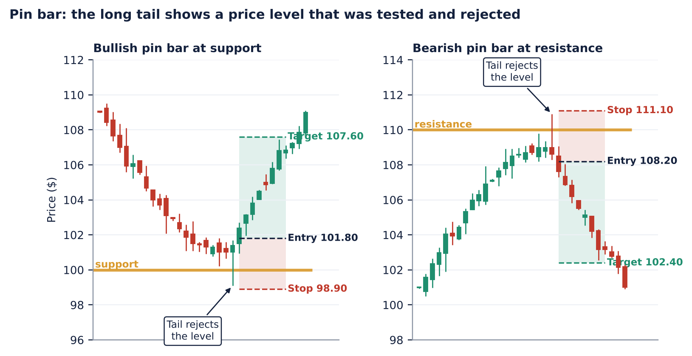

# Week 06 — The Pin Bar

## Learning objectives

- Recognise a pin bar (a tailed bar) by its shape.
- Say why a pin bar matters only at a key level.
- Write the entry, stop loss and target for a pin bar trade.
- List the cases in which a pin bar should be ignored.

## Lesson

### The shape

A **pin bar** is a bar with a long tail and a small body. The tail points to a price that was tested and rejected. A **bullish pin bar** has a long tail below the body: sellers pushed price down and buyers took it back. A **bearish pin bar** has a long tail above the body.

A practical rule of thumb: the tail should be at least about twice the length of the body, and the other tail should be short or absent. The bar should stand out from its neighbours. If you have to argue that it is a pin bar, it is not one.

### Location decides everything

A pin bar in the middle of nowhere is only a bar. The same bar at a key level, or at the 21 EMA in a trend, is a signal. Before you take a pin bar, ask three questions.

1. Is the tail rejecting a key level?
2. Does the trade go with the trend, or is there a clear reason for a reversal?
3. Is there room for price to reach the target before the next key level?

Figure 6.1. The tail rejects the key level. The entry is placed just beyond the pin bar's body side, the stop loss beyond the tail, and the target at twice the risk.

### Entry, stop loss and target

For a bullish pin bar: the entry is a stop order to buy just above the high of the pin bar. The stop loss goes just below the low of the tail. The target is at least twice the risk. For a bearish pin bar, reverse every direction. If the entry order is not triggered within a few bars, cancel it.

### When to ignore a pin bar

- The tail is short or the body is large.
- It is in the middle of a range and not at a key level.
- It goes against a strong trend with no reason.
- The next key level is too close for a target of twice the risk.

## Worked example

On the left of Figure 6.1, a key level (support) sits at $100.00. A bullish pin bar has open $101.00, high $101.70, low $99.10, close $101.40.

- **Body:** $0.40. **Lower tail:** $101.00 − $99.10 = $1.90, nearly five times the body. It passes the shape test.
- **Entry:** buy stop at $101.80, just above the high of $101.70.
- **Stop loss:** $98.90, just below the tail low of $99.10. Risk per share = $101.80 − $98.90 = **$2.90**.
- **Target:** $101.80 + 2 × $2.90 = **$107.60**. Reward per share = $5.80, so the risk reward is 1:2.

The bearish pin bar on the right is the mirror image around a resistance level at $110.00.

## Exercises

1. A bar has open $30.00, high $30.20, low $27.50, close $30.10. Is it a bullish pin bar? 

Answer
Yes in shape: the body is $0.10 and the lower tail is $2.50. It becomes a signal only if the tail is rejecting a key level.

2. For that bar, set the entry above the high by $0.10, the stop loss below the low by $0.10 and a target at twice the risk. 

Answer
Entry $30.30, stop loss $27.40, risk $2.90. Target = $30.30 + $5.80 = $36.10.

3. Why cancel the entry order if it is not filled after a few bars? 

Answer
The signal belongs to that moment. If price does not confirm it quickly, the reason for the trade has gone.

## Lab

Find ten pin bars on daily charts of stocks. Mark them all. Then keep only those that rejected a key level, and write down what price did in the next ten bars for each. How many of the ten did you reject?
