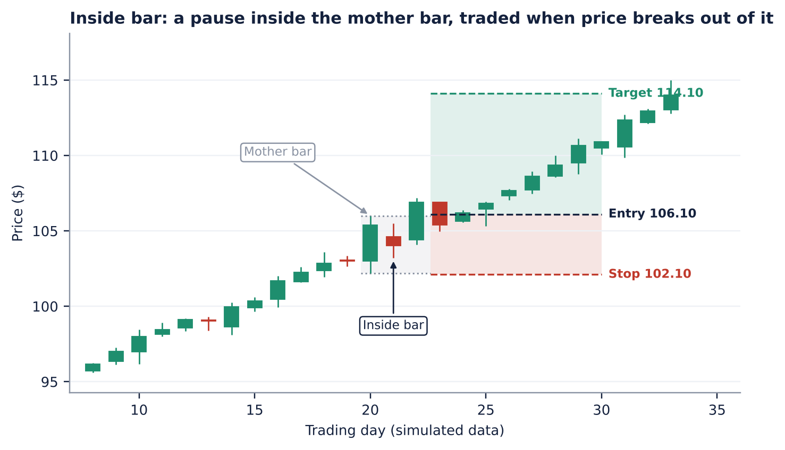

# Week 07 — The Inside Bar

## Learning objectives

- Recognise an inside bar and its mother bar.
- Say what an inside bar shows about the market.
- Write the entry, stop loss and target for an inside bar breakout.
- Decide when an inside bar is worth trading.

## Lesson

### The shape

An **inside bar** is a bar whose high is lower than the high, and whose low is higher than the low, of the bar before it. The bar before it is the **mother bar**. The whole inside bar fits inside the mother bar, as a small bar in the shadow of a large one.

### What it shows

The inside bar is a pause. After the mother bar made a big move, the next day neither buyers nor sellers could take control, and price stayed inside the mother bar's range. Pauses end, and the end is usually a move out of the mother bar. The trade is to be there when it happens.

### Entry, stop loss and target

The method is the same in both directions. With the trend, trade the break of the mother bar in the direction of the trend.

- **Entry:** a stop order just beyond the high of the mother bar (to buy) or the low of the mother bar (to sell).
- **Stop loss:** at the other end of the mother bar.
- **Target:** at least twice the risk.

Figure 7.1. The entry is above the mother bar's high, the stop loss below its low.

### Choosing which inside bars to trade

Inside bars are common. Most of them are not worth trading. Take the ones where:

- the mother bar is not too large. A huge mother bar means a huge stop loss and a small position size;
- the inside bar sits at a key level or the 21 EMA, or comes after a clear move in the direction of the trend;
- there is room to the next key level.

## Worked example

In Figure 7.1 the trend is up. The mother bar has open $103.00, high $106.00, low $102.20, close $105.40. The next bar has high $105.50 and low $103.20, so it is inside.

- **Entry:** buy stop at $106.10, just above the mother bar's high.
- **Stop loss:** $102.10, just below the mother bar's low. Risk per share = **$4.00**.
- **Target:** $106.10 + 2 × $4.00 = **$114.10**.

The next day price trades through $106.10 and the order is filled.

## Exercises

1. Mother bar: high $52.00, low $49.00. Next bar: high $51.40, low $49.60. Is it an inside bar? 

Answer
Yes. $51.40 is below $52.00 and $49.60 is above $49.00.

2. For that mother bar in an uptrend, set entry $0.10 above the high, stop loss $0.10 below the low, target at twice the risk. 

Answer
Entry $52.10, stop loss $48.90, risk $3.20, target $52.10 + $6.40 = $58.50.

3. Why does a very large mother bar make a poor trade? 

Answer
The stop loss is far from the entry, so the position size must be small, and the target at twice the risk may be beyond the next key level.

## Lab

Find five inside bars on daily charts. For each, write the entry, stop loss and target, and the next key level. Which of the five would you not take, and why?
