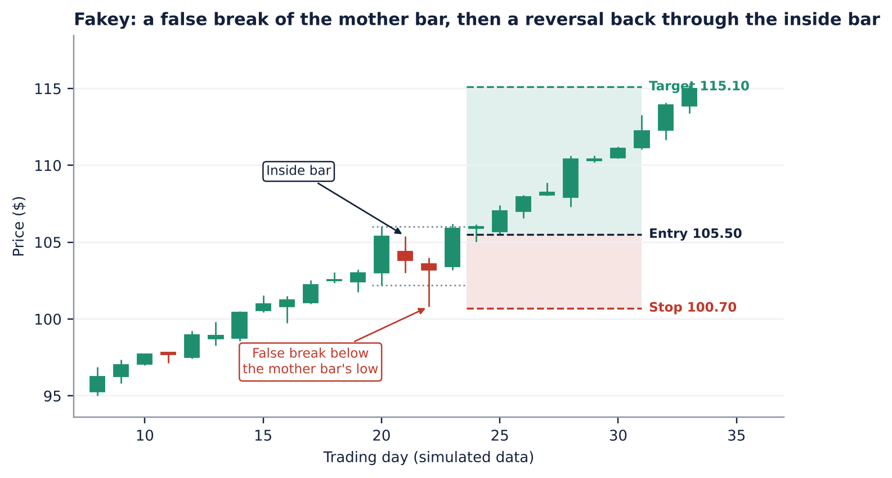

# Week 08 — The Fakey

## Learning objectives

- Describe a fakey as an inside bar followed by a false break.
- Explain why a false break can be a stronger signal than a clean breakout.
- Write the entry, stop loss and target for a fakey.
- Tell a fakey from an inside bar that simply breaks out.

## Lesson

### The shape

A **fakey** begins as an inside bar. Price then breaks out of the mother bar on one side, and the break fails: price closes back inside the mother bar's range. The break was false. The trade is in the opposite direction, because those who traded the false break are now trapped and must exit.

### Why it works

Many traders place orders just beyond the mother bar. When price reaches those orders and fails to continue, the traders who entered must close at a loss, and that exit adds pressure in the direction of the reversal. The fakey is a signal that comes from the failure of the obvious trade.

### Entry, stop loss and target

For a bullish fakey (a false break below the mother bar):

- **Entry:** a buy stop just above the high of the inside bar, or of the bar that made the false break, after price closes back inside the range.
- **Stop loss:** just below the low of the false break.
- **Target:** at least twice the risk.

Reverse every direction for a bearish fakey.

Figure 8.1. The false break below the mother bar's low fails, and price closes back inside. The trade is long, with the trend.

### With the trend, or at a key level

A fakey is best with the trend, as in Figure 8.1, or at a key level. A fakey against the trend needs a clear reason, so apply the same questions as for the pin bar. If the false break pokes below a key level, the signal is stronger.

## Worked example

In Figure 8.1 the mother bar has high $106.00 and low $102.20. The inside bar has high $105.40 and low $103.00. The next bar trades down to $100.80, below the mother bar's low, and closes at $103.20, back inside the mother bar's range. That is a false break.

- **Entry:** buy stop at $105.50, just above the inside bar's high.
- **Stop loss:** $100.70, just below the false break's low. Risk per share = **$4.80**.
- **Target:** $105.50 + 2 × $4.80 = **$115.10**.

## Exercises

1. Mother bar low $49.00. The next bar trades down to $48.20 but closes at $49.30. What has happened? 

Answer
A false break of the mother bar's low. If the bar before it was an inside bar, this is a bullish fakey.

2. Why is the stop loss placed below the false break's low? 

Answer
If price returns below that low, the false break was real, and the idea for the trade is wrong.

## Lab

Find three fakeys and three inside bars that broke out cleanly, all in the direction of the trend. Compare the next ten bars of each. Write one paragraph on what you notice, and keep it in your journal.
