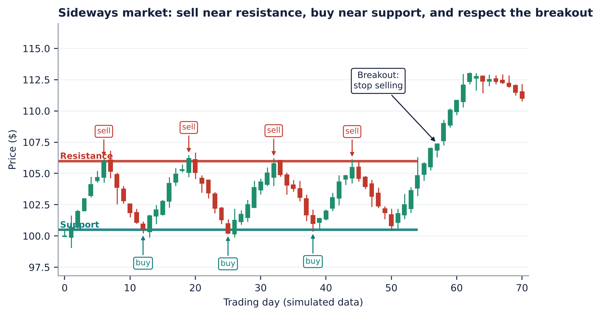

# Week 10 — Sideways Markets, Reversals and Counter-Trend Trades

## Learning objectives

- Recognise a sideways market and trade it with care.
- Say what a reversal looks like and what it needs.
- List the extra risks of a counter-trend trade.
- Decide when to stay out.

## Lesson

### Sideways markets

When price moves between a support level and a resistance level without making progress, the market is sideways. The key levels are the boundaries. A simple plan is to buy near support with a bullish signal and to sell near resistance with a bearish signal, with the stop loss just beyond the level. The plan stops when a breakout arrives.

Figure 10.1. Buy near support and sell near resistance while the levels hold. After the close above resistance, stop selling.

A sideways market has a small distance between the levels. Check that the reward is at least twice the risk before you take a trade; if the levels are too close for that, there is no trade.

### Reversals

A **reversal** is the end of one trend and the start of the opposite one. In Week 3 you saw its stages: a failure to make a new high or low, a break of the last swing point and then a new sequence. A reversal trade tries to enter early, at a key level and with a signal such as a pin bar or a fakey.

### Counter-trend trades

A trade against the trend is called **counter-trend**. It can pay well, because the move back to the other side of the range is large. But it carries extra risk:

- Momentum is against you.
- A key level that held three times can break on the fourth.
- The 21 EMA points the wrong way.

If you trade counter-trend, ask for more: a very clear key level, a very clear signal and a target that is at least twice the risk. Many traders reduce the position size for these trades.

### Staying out

When the weekly chart and the daily chart disagree, when no key level is close, or when the bars are messy, the correct trade is no trade. Cash is a position.

## Worked example

In Figure 10.1 the support is about $100.50 and the resistance about $106.00, a range of $5.50. A sell near resistance with a stop loss $1.00 above has a risk of about $1.00 and a target at support of about $5.50 away: a risk reward better than 1:5, so the trade is worth planning. After the breakout on day 57 the sell trades have no more value, and the market is a trend again.

## Exercises

1. A sideways market has support at $20.00 and resistance at $21.00. You want a risk reward of 1:2. Is a sell at $20.90 with a stop loss at $21.10 acceptable? 

Answer
Risk = $0.20. The target at support is $20.90 − $20.00 = $0.90 away, which is 4.5 times the risk, so yes it passes the 1:2 test. Check that the signal and the levels are clear.

2. Name two extra risks of a counter-trend trade. 

Answer
Momentum is against you, and a key level can fail. The 21 EMA also points the wrong way.

## Lab

Classify five daily charts as uptrend, downtrend or sideways. For each sideways chart, mark the two key levels and measure the distance in dollars. For each trending chart, write what a counter-trend trade would risk.
