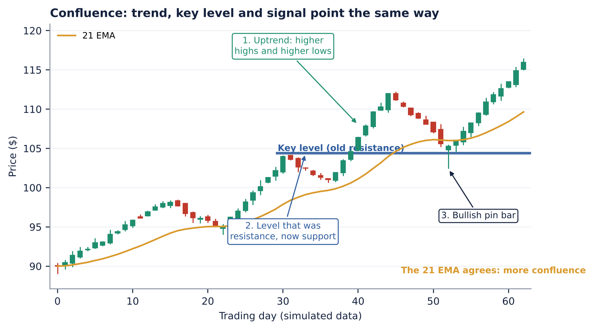

# Week 11 — Confluence

## Learning objectives

- Define confluence as several independent reasons agreeing at one price and time.
- List the four factors used in this course.
- Count the confluence of a setup and set a minimum count.
- Explain why more confluence does not make a trade certain.

## Lesson

### The four factors

**Confluence** means that several reasons point the same way at the same place. In this course there are four:

1. **Trend:** the trade is with the trend on the weekly chart and the daily chart.
2. **Key level:** the signal sits at a clear support or resistance level.
3. **21 EMA:** price is at the 21 EMA and it points with the trade.
4. **Signal:** a clear pin bar, inside bar or fakey.

A setup with one factor is a bar. A setup with two is worth watching. A setup with three or four is a trade to plan.

Figure 11.1. Four factors in one place: the trend, the old resistance turned support, the 21 EMA and the pin bar.

### Counting

Write the count in your journal before you enter. Count a factor only if it is clear, and do not count a factor you must argue for. Set a minimum in your trading plan, for example three of four. A minimum count takes the guesswork out of the choice and helps you skip weak trades.

### Limits

Confluence raises the probability that a trade works. It does not make it certain, and any trade can lose. This is why every trade has a stop loss and a position size set by the risk (Week 12). Do not add factors to justify a trade you already want to take.

## Worked example

In Figure 11.1 the weekly trend is up and the daily chart shows higher highs and higher lows. The old resistance at about $104.40 now acts as support. The bar on day 52 has open $104.80, high $105.50, low $102.40, close $105.30 and touches the 21 EMA.

| Factor | Clear? | Count |
|---|---|---|
| Trend | Yes, up on both time frames | 1 |
| Key level | Yes, old resistance now support | 1 |
| 21 EMA | Yes, price is at the rising 21 EMA | 1 |
| Signal | Yes, a bullish pin bar (tail $2.40, body $0.50) | 1 |

The count is 4 of 4. Entry $105.60, stop loss $102.30, risk **$3.30**. Target $105.60 + 2 × $3.30 = **$112.20**.

## Exercises

1. A pin bar is clear and at a key level, but the weekly trend is down and the trade is a buy. What is the count and what does it need? 

Answer
The count is 2 of 4 at most: key level and signal. It is counter-trend, so it needs the stronger reasons of Week 10, or it should be skipped.

2. Why write the count before entering? 

Answer
After you enter, emotion shapes how you judge the setup. A count written before is honest and can be checked in the journal.

## Lab

Count the confluence on ten setups on your own daily charts using the four factors. Keep only the setups with the count that your trading plan requires, and write the next ten bars for each. Did the higher counts work out better?
