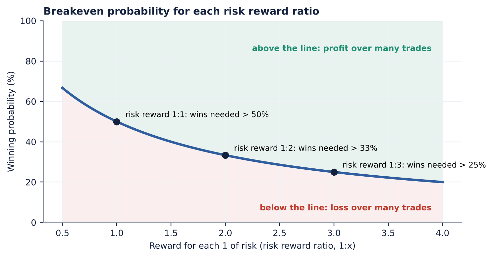
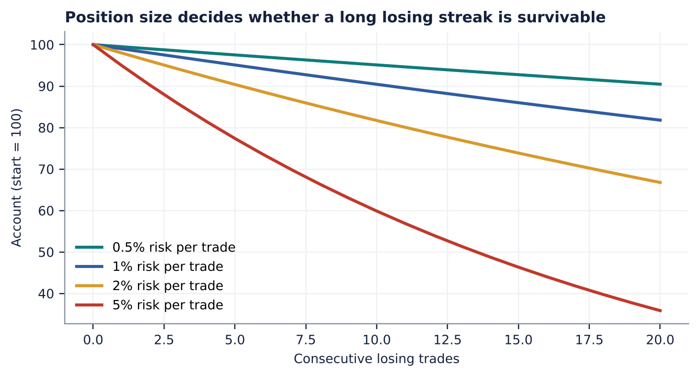

# Week 12 — Stop Loss, Risk Reward and Position Sizing

## Learning objectives

- Choose a stop loss from the chart and not from the amount you hope to lose.
- Calculate a risk reward ratio and the winning probability needed to break even.
- Calculate a position size from the risk per trade.
- Show why a small risk per trade makes a losing streak survivable.

## Lesson

### Money management

Money management is what keeps you in the game. The signals decide when you trade. Money management decides how much you can lose when you are wrong, and you will be wrong often. It has three parts.

**1. Stop loss.** Place it where the idea is wrong, beyond the tail of the pin bar, the end of the mother bar or the last swing point. Never move it further away.

**2. Risk reward.** The reward is the distance from entry to target. The risk is the distance from entry to stop loss. A 1:2 risk reward means the reward is twice the risk.

**3. Position size.** Choose the risk per trade as a small percentage of the account, then set the number of shares so that a loss at the stop loss costs exactly that amount.

### The formula

Risk per trade = account size × risk percentage

Position size (shares) = risk per trade ÷ (entry − stop loss)

For a short trade use (stop loss − entry). Round down to a whole number of shares.

### Why risk reward matters

With a risk reward of 1:2, you break even if you win about one trade in three. With 1:1 you need to win half of them. A higher reward for the same risk lowers the winning probability that you need.

Figure 12.1. The curve shows the winning probability needed to break even. Costs such as commission and the spread push the line up a little.

### Losing streaks

Even a good method has losing streaks. What decides whether you survive one is the risk per trade.

Figure 12.2. After 20 losses in a row, an account risking 1% per trade is at about 82. An account risking 5% is at about 36.

## Worked example

Account $10,000, risk 1% per trade, entry $50.00, stop loss $48.40, target $53.20.

- Risk per trade = $10,000 × 1% = **$100**.
- Risk per share = $50.00 − $48.40 = **$1.60**.
- Position size = $100 ÷ $1.60 = 62.5, so **62 shares**.
- Real risk = 62 × $1.60 = $99.20. Reward = 62 × $3.20 = $198.40, so the risk reward is 1:2.

A second case: account $25,000, risk 0.5% = $125, entry $99.60, stop loss $96.40. Risk per share is $3.20, so the position size is $125 ÷ $3.20 = 39.06, or **39 shares**.

## Exercises

1. Account $8,000, risk 1%, entry $20.00, stop loss $19.00. How many shares? 

Answer
Risk per trade $80. Risk per share $1.00. Position size = 80 shares.

2. What winning probability breaks even at a risk reward of 1:3? 

Answer
25%: the average win is three times the average loss, so one win in four pays for three losses.

3. After 10 losses in a row at 2% risk per trade, what is left of an account that started at 100? 

Answer
100 × 0.98^10 ≈ 81.7.

## Lab

Fill in the position size table in your trading plan for your own account size and three possible risk percentages. Then pick a stock from your charts and calculate the position size for a real setup.
