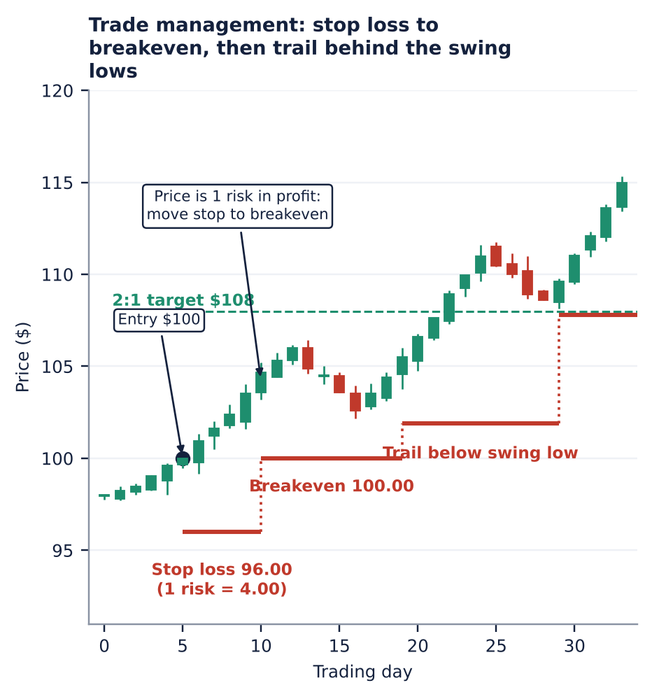

# Week 13 — Trade Management

## Learning objectives

- Explain why a plan for after the entry matters as much as the entry.
- Move a stop loss to breakeven with a clear rule.
- Trail a stop loss behind the swing points of a trend.
- Choose between taking the target and trailing.

## Lesson

### After the entry

Once the order is filled, the trade has two possible ends: the stop loss or the target. In between, you have a decision to make every day. **Trade management** is the set of rules that you write before the entry, so that emotion does not make the decisions for you.

### Breakeven

When price has moved in your favour by the amount that you risked, move the stop loss to the entry price. This is **breakeven**. If price returns to your entry, the trade closes at about zero, and the loss of the trade is taken out of the game. The rule in this course: move the stop loss to breakeven when the trade is one times the risk in profit.

### Trailing

In a trend, price makes new swing lows above the old ones. A **trailing** stop loss follows them: after each new swing low, move the stop loss to just below it. Never move it backwards. The trailing stop loss lets a winner run and still protects most of the profit.

### Taking the target

A fixed target at twice the risk is simple, and it is the default. Trailing can pay more in a strong trend, and it can pay less in a choppy one. Choose one way in your trading plan before the trade and do not change it because of how you feel.

Figure 13.1. Entry $100, risk $4. The stop loss moves to breakeven after price reaches $104, then trails below each swing low.

### Rules that keep you safe

- Never move a stop loss further from the entry.
- Never add to a losing trade.
- Do not take profit early because of fear, and do not hold a loser because of hope.

## Worked example

Figure 13.1: entry $100.00, stop loss $96.00, risk $4.00, target $108.00.

1. **Day 10:** price reaches $104.00, one times the risk in profit. Move the stop loss to $100.00 (breakeven).
2. **Day 19:** a swing low near $102.60 formed on day 16 and price is above it. Move the stop loss to $101.90, just below the swing low.
3. **Day 29:** another swing low has formed near $108.60. Move the stop loss to $107.80.

Price passes the $108.00 target around day 21 but keeps rising. A trader who took the target banked $8.00 per share, which is twice the risk. A trader who trailed still holds the trade, with a stop loss at $107.80 that locks in at least $7.80 per share. Either choice follows a rule.

## Exercises

1. Entry $40.00, stop loss $38.00. At what price do you move the stop loss to breakeven? 

Answer
Risk is $2.00, so when price reaches $42.00 move the stop loss to $40.00.

2. Why must a trailing stop loss never move backwards? 

Answer
Moving it back increases the risk again and takes away the protection that the earlier move created.

## Lab

Take three of your earlier trade plans. Replay each bar by bar on your chart and write the day on which you would move to breakeven and each trail. Compare the result with taking the 1:2 target.
