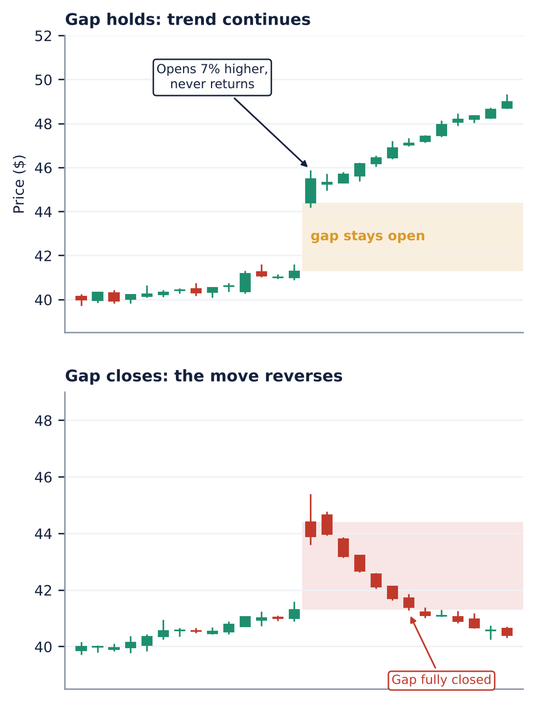
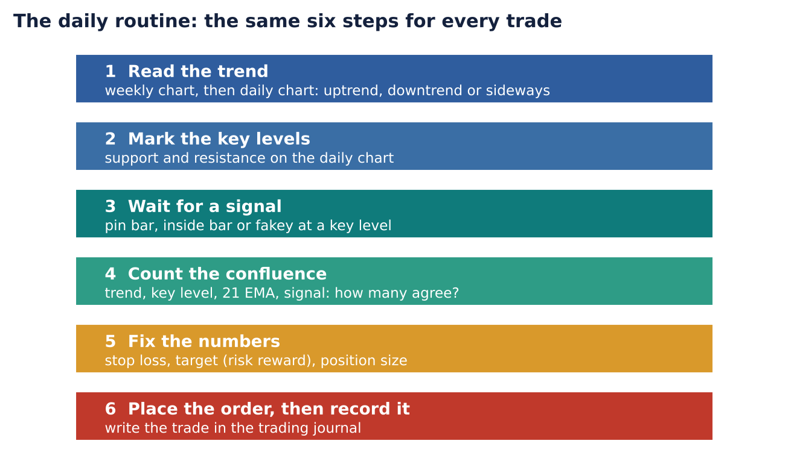

# Week 14 — Gaps, News and the Daily Routine

## Learning objectives

- Say what a gap is and how it can break a stop loss.
- Decide what to do when news is due.
- Write a daily routine that you can follow in the same order every day.
- Keep a trading journal as part of the routine.

## Lesson

### Gaps

A **gap** appears when a stock opens well above or below the previous close and no trading takes place in between. Gaps usually follow news, which arrives after the close or before the open. A gap can take price straight through your stop loss. A stop order becomes a market order once it is reached, so you can be filled well beyond your stop price, and the loss can be larger than you planned.

Figure 14.1. The first bars after a gap decide whether it holds or fails.

### News

News moves prices, and it often arrives at known times. The rule of this course is simple: if important news about the stock is due before your trade can reach its target, stay out of the trade. Do not hold a position through news hoping to be lucky, because the gap risk is not in your position size calculation.

### The daily routine

A routine is the same steps in the same order. It saves you from deciding things in a hurry.

Figure 14.2. The routine takes about thirty minutes after the close. It ends in the trading journal.

### The trading journal

For each trade, write down the signal, the key level, the confluence count, entry, stop loss, target, position size, exit, the result in multiples of the risk and whether you followed the plan. Add the emotion you noticed. Without a journal there is no way to know what works.

## Worked example

On Figure 14.1 the left stock closes at $41.30 and opens the next day at $44.40, a gap of about 7%. It does not trade back into the gap, and the trend continues: the gap held. The right stock gaps up the same way, then trades down through the open and closes the gap within seven days. If you had bought the open at $44.40 with a stop loss at $43.40, the stop loss would have been hit.

A buyer who waits for the first bars to show whether the gap holds will miss part of the move, and will avoid more false moves.

## Exercises

1. A stock closes at $30.00. Your stop loss is $28.50. It opens at $27.00 after bad news. Where are you likely to be filled? 

Answer
At about $27.00 or near it, not at $28.50. The stop order becomes a market order once price reaches it, and price has already gapped through.

2. Why stay out of a trade if news is due before the target is reached? 

Answer
The gap risk is larger than the risk used in the position size, so one trade can lose far more than the plan allows.

## Lab

Write your own daily routine on one page, using the six steps. Run it for five trading days on your demo account, even on the days when you find no trade, and record each day in the journal.
