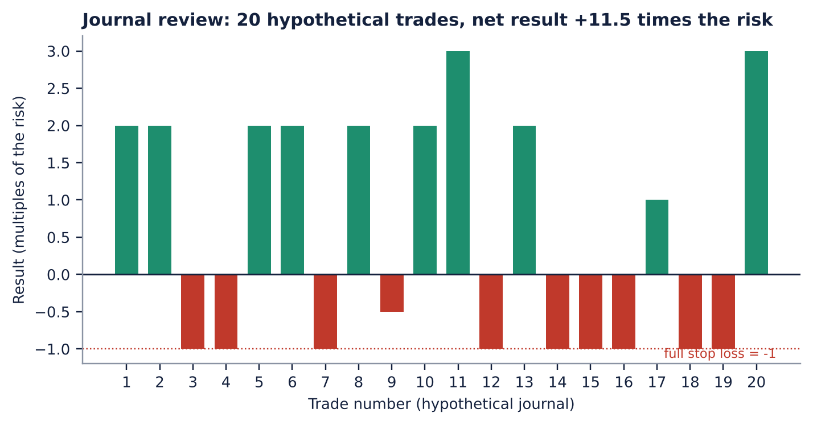
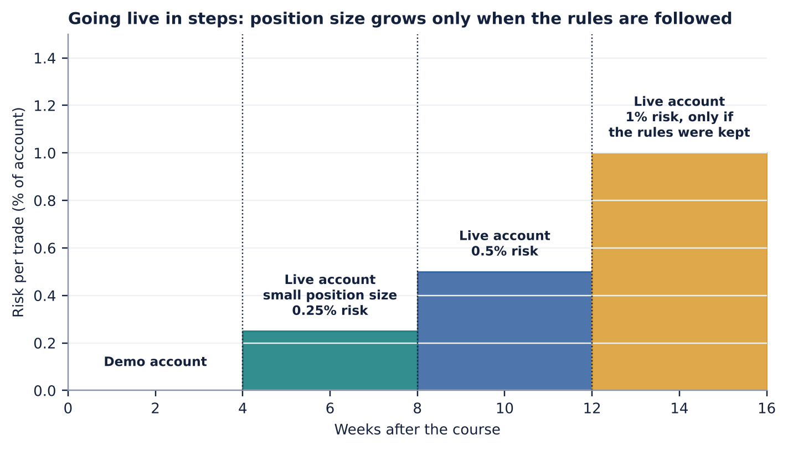

# Week 15 — The Trading Plan, Psychology and Going Live

## Learning objectives

- Complete a written trading plan that covers every part of the course.
- Name the emotions that damage a trader and a rule for each.
- Review a trading journal of 20 trades.
- Go live in steps, with the risk per trade rising only when the rules have been followed.

## Lesson

### The trading plan

The trading plan on the course page is the product of the course. It records the time frames, the setups, the minimum confluence, the entry, the stop loss, the target, the position size, the trade management, the rules about news and the routine. Write it in your own words. Read it before every trade, and change it only after a review of the journal, never in the middle of a trade.

### Psychology

The method is simple. Following it is hard. The usual enemies are:

- **Fear:** you skip a good setup after two losses, or you close a winner too early. Rule: if the setup meets the plan, take it, with the planned position size.
- **Greed:** you increase the position size after a win, or you move the target further away. Rule: the risk per trade is fixed.
- **Impatience:** you enter before the signal bar is complete. Rule: wait for the close of the bar.
- **Hope:** you move the stop loss further away. Rule: never.
- **Revenge:** you take a trade to win back a loss. Rule: after the number of losses set in the plan, stop for the day and review.

You will feel each of these. **Discipline** means following the plan while you do. **Patience** means waiting for the setup.

### Reviewing the journal

After 20 trades, count the trades, the winners and the losers, and the average result in multiples of the risk. Then count how many trades followed the plan. A trade that followed the plan and lost is a good trade. A trade that broke the plan and won is a bad one, because it teaches the wrong habit.

Figure 15.1. A hypothetical journal. Most losses stay at one times the risk or less, because the stop loss was kept.

### Going live

Start on the demo account. When the journal shows 20 trades that followed the plan, go live with a small risk per trade. Raise it only after the rules have been followed, never after a good week.

Figure 15.2. A suggested ramp. Your own plan may differ, and the broker's rules for small accounts and day trading must be checked before you go live.

## Worked example

A trader reviews 20 demo trades. There are 9 winners and 11 losers. Four trades broke the plan, because the stop loss was moved. The trader writes: the method is not the problem, because the trades that followed the plan were fine; the problem is the stop loss that was moved, which comes from hope. The rule that is added to the plan: the stop loss order is placed at the same time as the entry, and the platform's order for moving it is not used.

## Exercises

1. After a loss, you feel the urge to double the position size on the next trade. What is it, and what does the plan say? 

Answer
It is greed combined with revenge. The plan says the risk per trade is fixed, so the position size is calculated by the same formula.

2. A trade followed every rule and lost. Was it a good trade? 

Answer
Yes. A loss is part of the probabilities, and the plan was followed.

## Lab

Complete the trading plan, with every field filled in. Finish the first 20-trade journal on the demo account. Write a one-page review that answers: which setups worked, which emotion cost me the most, and what is the one rule I will add to the plan?
