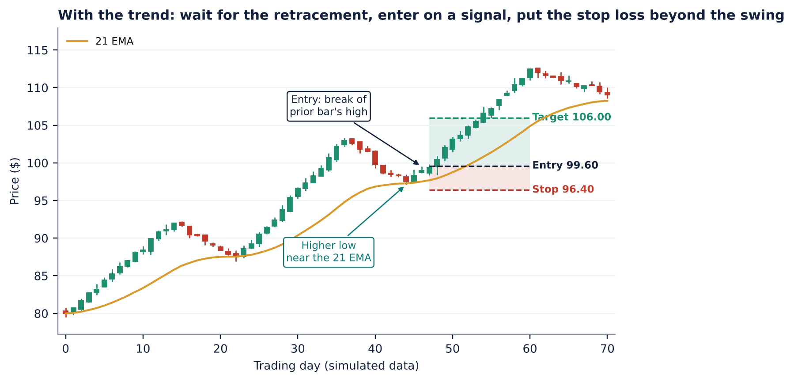

# Week 09 — Trading with the Trend: The Retracement Entry

## Learning objectives

- Explain what a retracement is and where it often ends.
- Combine the trend, a key level and the 21 EMA to choose a place to enter.
- Plan a trade with the trend from entry to target.
- Choose a stop loss beyond the last swing point.

## Lesson

### The idea

In an uptrend, price does not go straight up. It rises, **retraces**, and rises again. Each retracement is a chance to buy at a better price and with a closer stop loss than a chase of the breakout. The same is true in a downtrend, when price rallies and then falls again.

### Where retracements end

Look for the retracement to stop at one of three places:

- a **key level**, especially an old resistance that has become support;
- the **21 EMA**;
- the last **swing low** of the trend (the higher low).

The best retracements stop where two of them meet. That is confluence, and Week 11 teaches how to count it.

### The plan

1. Confirm the trend on the weekly chart and the daily chart.
2. Wait for the retracement to reach a place from the list above.
3. Wait for a signal: a pin bar, an inside bar or a fakey.
4. Enter above the signal bar. Put the stop loss beyond the swing low and the target at twice the risk or more.

Figure 9.1. A higher low near the 21 EMA, then an entry above the prior bar's high.

### Patience

The hard part is waiting. Price will often fall short of your place, or will not give a signal. Skipping those trades is part of the method. Good trades come to the trader who waits.

## Worked example

In Figure 9.1 the trend is up with swing highs at $103 and $112.5. After the high near $103 price retraces to about $97.5, close to the 21 EMA, and a bar closes at the prior bar's high.

- **Entry:** $99.60.
- **Stop loss:** $96.40, below the swing low. Risk per share = **$3.20**.
- **Target:** $99.60 + 2 × $3.20 = **$106.00**.

Price later reaches the target.

## Exercises

1. In a downtrend, where would you look to sell? 

Answer
On a rally that stops at a key level (an old support that has become resistance), at the falling 21 EMA, or at the last lower high, followed by a bearish signal.

2. Entry $60.00, stop loss $57.50. What is the target for a risk reward of 1:2? 

Answer
Risk $2.50, so the target is $60.00 + $5.00 = $65.00.

## Lab

Find two retracements on daily charts of US stocks in a clear uptrend. For each, write the plan above before you look at what happened next. Then check and record the result in your journal.
